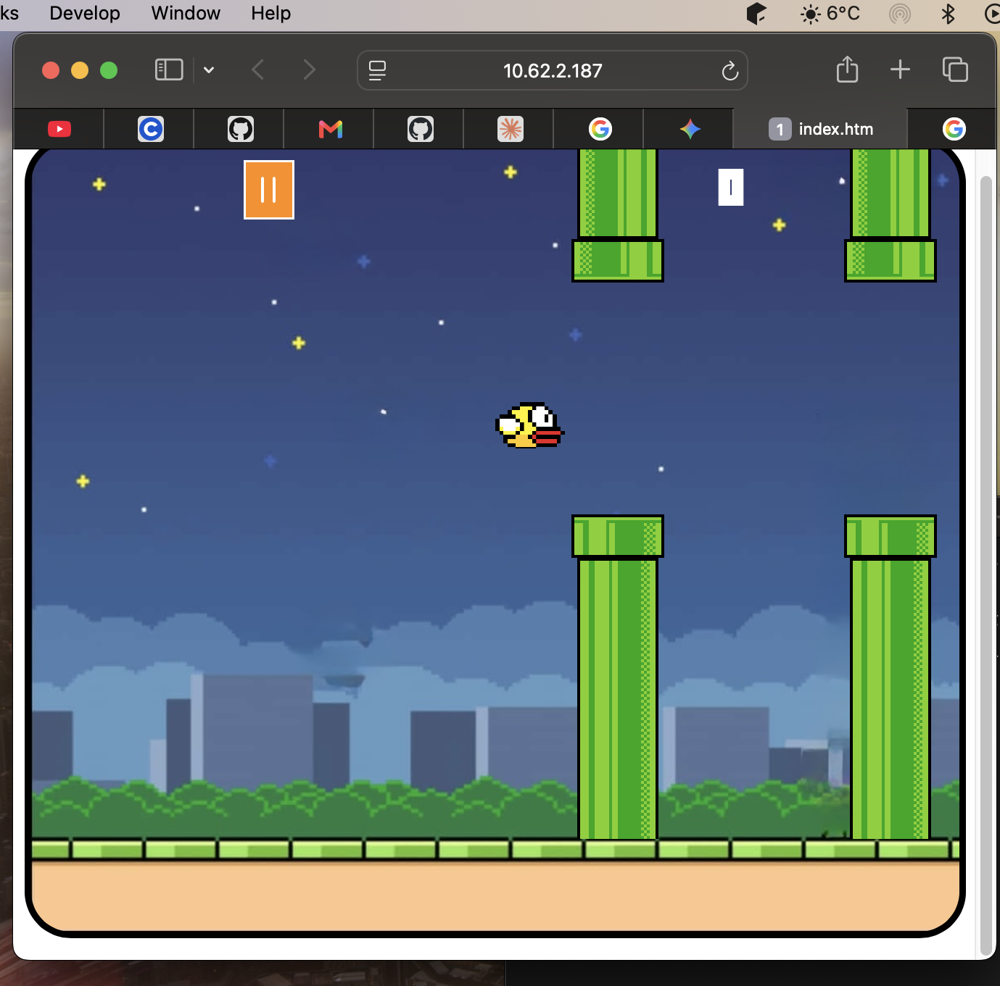

# FlappyThings
A flappy bird style browser game built with vanilla html,css,javascript.Tap to one key to keep your character in the air,go through the space between pipes and reach higher score

# Gameplay Image

# Getting Startet
No installation required.Open index.html in the browser.
"""
1. ### Clone the repository : 
git clone https://github.com/e.672/flappythings.git
2. ### Go into the project folder : 
cd flappythings
3. ### Open index.html in your browser :
open index.html 

You can also use the Live Server extension in VS Code for automatic reloading while you develop.

# Project Structure
flappythings/
├── bird_animation.html
├── flappy-font.ttf
├── index.html  
├── images/
├── main.css      # Styles
├── main.js       # Game logic
└── README.md

# Built With 
* HTML
* CSS
* JavaScript

